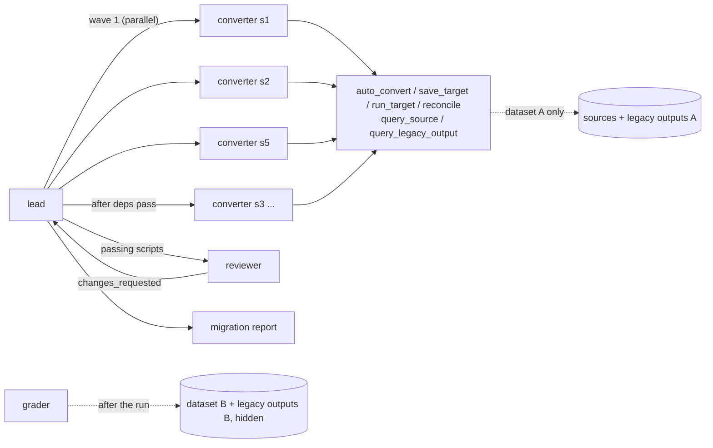

# migration-crew

[](https://github.com/amritanshagrawal99/migration-crew/actions/workflows/ci.yml)
[](LICENSE)

**A crew of Claude agents that migrates a legacy Teradata ETL estate to DuckDB.** The crew converts every job, runs
it, reconciles its output against the legacy system's row by row, and fixes what differs. Each job is then graded on
**a dataset the agents never saw**, so a conversion that only patches the visible data fails.

Built on the [Claude Agent SDK](https://code.claude.com/docs/en/agent-sdk/overview): a lead agent, converter and
reviewer subagents, in-process MCP tools, structured output and a spend cap. Claude Opus 5.5 by default.



## The estate

9 Teradata BTEQ scripts in a dependency graph, from staging (`s1`, `s2`, `s5`) to aggregates, a top-10 with ties,
churn flags and a type-2 dimension, plus [platform notes](estate/legacy/PLATFORM_NOTES.md). Each script hides
Teradata behaviour that DuckDB doesn't share:

| Trap | Where | What goes wrong in DuckDB |
|---|---|---|
| Session-mode comparison ignores case and trailing spaces | s1, s2, s5, s9 | `segment = 'gold'` misses `'Gold   '`; the padded-SKU join returns 0 of 2443 rows; the dimension sees 76 false changes |
| `RoundHalfwayMagUp = FALSE` (round half to even) | s3 | `CAST(... AS DECIMAL(14,1))` rounds 1615.85 to 1615.9 instead of 1615.8 |
| `ZEROIFNULL`, `TOP n WITH TIES` | s1, s7 | don't exist / don't parse |
| Integer division truncates; NULLs sort first | s3, s4 | the auto-converter (sqlglot) already handles these |

Without the agents, the auto-converter's output (sql-migration-accelerator on sqlglot) fails 6 of 9 scripts, and
the downstream scripts fail with them. A test checks this.

**How it's graded.**
- **Dataset A** (300 customers) is what the agents work with. They see its sources and the legacy outputs, but only
  through diffs and read-only queries.
- **Dataset B** (520 customers, another seed) is hidden from them. It also has spellings A doesn't, such as
  `'gOLD'`, `'sHIPPED'` and `'Sku0005'`.
- After the run, every saved conversion runs on both datasets and is reconciled with the legacy outputs. A
  conversion that matches A and fails B counts as **overfit**. A test shows that listing dataset A's spellings
  instead of implementing the rule is caught this way.
- The report's claimed status for every script is checked too.

## Results: crew vs one agent

### 9 scripts

Same model (Claude Opus 5.5, effort medium), same tools, same budget:

| Mode | Unseen dataset B | Overfit | Report claims correct | Review | Tool calls | Time | Estimated cost |
|---|---|---|---|---|---|---|---|
| **crew**: lead + converters + reviewer | **9 / 9** | 0 | 9 / 9 | 9 approved | 223 (20 delegations) | 266 s | $3.02 |
| **solo**: one agent | **9 / 9** | 0 | 9 / 9 | 9 approved | 68 | 177 s | $0.73 |

**At this size the crew buys nothing.** Both modes migrate every script, find every trap and generalize to the
unseen data. One agent does it in 2/3 of the time for 1/4 of the cost, because all nine scripts fit comfortably in
its context. The crew pays for every brief and handoff: each converter and reviewer starts from zero and re-reads the
legacy SQL and platform notes.

The crew's working style is visible in [`runs/published/crew`](runs/published/crew):
- **Waves.** It converted s1, s2 and s5 in parallel, then s3, s4 and s9 once their dependencies passed.
- **Verification.** The lead re-ran reconcile on every claimed pass.
- **Deep review.** The reviewer ran its own edge-case probes. It also noticed that a Teradata `GROUP BY` compares
  case-insensitively too, which no trap tests.

One thing the agents got right that I didn't: my first hidden reference used DuckDB's `round_even()`. On DuckDB
1.5 that goes through a double, so 1164.65 rounds to 1164.7 instead of 1164.6, and CI on Python 3.10 caught the
mismatch. Both agents had written the rounding in exact integer arithmetic, so their conversions pass on DuckDB 1.5
and 2.0 alike. The reference now does the same.

### 48 scripts

Does the crew start to pay off once the estate is bigger? `migration-crew generate` builds estates from
templates, one family per kind of legacy job:
- filters, IN lists and padded joins with case-varying literals;
- half-even rounding casts and `TOP n WITH TIES`;
- `ZEROIFNULL`;
- integer division, NULL ordering and date arithmetic as control families, which the auto-converter already gets
  right;
- dependent jobs that read earlier outputs.

Each template writes the Teradata script and its hidden DuckDB reference together, so every pair is correct by
construction. On the 48-script estate (seed 7), the reference passes both datasets, and the auto-converter passes
only the 3 control scripts. A test checks the same on a generated estate.

| Mode | Unseen B, DuckDB 2.0 | Unseen B, DuckDB 1.5.6 | Tool calls | Time | Estimated cost |
|---|---|---|---|---|---|
| **crew** | **48 / 48** | **48 / 48** | 740 (48 converter + 25 reviewer delegations) | 1018 s | $11.39 |
| **solo** | **48 / 48** | **40 / 48** | 216 | 268 s | $1.32 |

**On the engine the agents tested against, there is still no difference.** Both modes pass all 48 on unseen data:
one agent saw every script, learned each trap once and applied it everywhere. The crew took 3.8× the time and 8.6×
the cost.

**The difference shows up on a second engine version.** For half-even rounding, the solo agent wrote
`round_even(x, 1)`.
- That is exact on DuckDB 2.0, which is what the agents ran on.
- On DuckDB 1.5 it goes through a double, so halfway values round the wrong way (1164.65 becomes 1164.7, not
  1164.6). 13 conversions fail on at least one dataset: 12 on A and 8 on unseen B.

The crew's first rounding converter (`g05`) wrote exact integer arithmetic instead, and recorded why: "round_even
on DECIMAL goes through a double". The lead then put that pattern into every later brief, and reviewers checked
for it. That is the crew's real advantage: one agent's finding becomes a rule that every later conversion and
review applies. Its notes also record assumptions a migration lead needs, such as "assumes amount has scale 2".

Two caveats:
- This is one run per mode, and in the 9-script run the solo agent did write exact rounding.
- Parity proven on one engine version is not parity on another. Grades now record the DuckDB version, and CI
  re-grades the published 9-script runs on DuckDB 1.5 (Python 3.10) and 2.x.

**The crew's first attempt failed for an infrastructure reason** ([`crew-first-attempt`](runs/published/n48/crew-first-attempt)).
1. The lead delegated 10 converters in one message.
2. The CLI rejected the ones over the concurrency cap of 4 ("do not retry").
3. The lead then ended its turn while the other converters were still working.
4. With a required structured report, ending the turn ended the run: 8 of 48 converted, 40 never started.

The fix is a prompt rule: delegate in waves of at most 4 and keep going while scripts remain. Each finished wave
re-invokes the lead. A crew needs its own scheduling discipline, which one agent working through a list never
does.

Runs: [`runs/published/n48`](runs/published/n48). To reproduce the estate and re-grade a run:
`migration-crew generate --scripts 48 --out estates/n48`, then `migration-crew grade runs/published/n48/crew`.

## Design

- **Parity, not correctness.** The agents must reproduce the legacy outputs exactly, including behaviour they think
  is wrong; suspected legacy bugs are recorded as notes. That is the actual job in a migration.
- **The data can't be gamed.**
  - The agents work on dataset A only. Dataset B and the reference SQL live in `grading/`, which no tool can reach.
  - Converted SQL runs in an in-memory DuckDB with external access disabled and the configuration locked. It can't
    read files, `ATTACH` the grading database, or `COPY` anything out, and a test checks all three.
  - Query tools take one `SELECT`, checked with sqlglot against an allowlist of tables.
- **Tools do the measuring.** `reconcile` compares by key and reports:
  - missing and extra keys, and duplicate keys;
  - per-column mismatch counts, with sample rows showing the legacy and new values.

  The model reads diffs, not raw tables.
- **The lead verifies, never trusts.** Subagent claims are re-checked with `reconcile`, and the report must take
  statuses from the workspace state. The grader checks them anyway.
- **Bounded.** A spend cap, turn caps per agent, a subagent depth of 1, at most 4 concurrent subagents, and no
  built-in Claude Code tools other than `Agent`.

## Run it

```bash
pip install git+https://github.com/amritanshagrawal99/migration-crew
migration-crew run --mode crew        # or --mode solo; then grades on both datasets
migration-crew grade runs/<workspace> # re-grade a finished run
migration-crew tool runs/x reconcile '{"script": "s5_order_lines_enriched"}'   # any tool, no model
migration-crew generate --scripts 48 --out estates/n48   # a bigger estate from templates (datasets + hidden reference)
migration-crew run --mode solo --estate estates/n48 --budget 40
```

Authenticate the Agent SDK with an `ANTHROPIC_API_KEY`, or with `CLAUDE_CODE_OAUTH_TOKEN` from `claude setup-token`.
`python estate/build.py` regenerates both datasets and the legacy outputs.

## Tests

`pytest` runs without a model:
- The reference passes both datasets.
- Auto-conversion fails where the traps are.
- A dataset-A-fitted conversion is flagged as overfit.
- False status claims are caught.
- The SQL sandbox holds against ATTACH, file reads and COPY.
- The query tools are read-only and scoped.
- Grading data never appears inside the estate.
- A generated estate is sound: the reference passes both datasets, and auto-conversion fails exactly the trap scripts.
- The published runs still grade as reported on this machine's DuckDB.

## License

[MIT](LICENSE)
